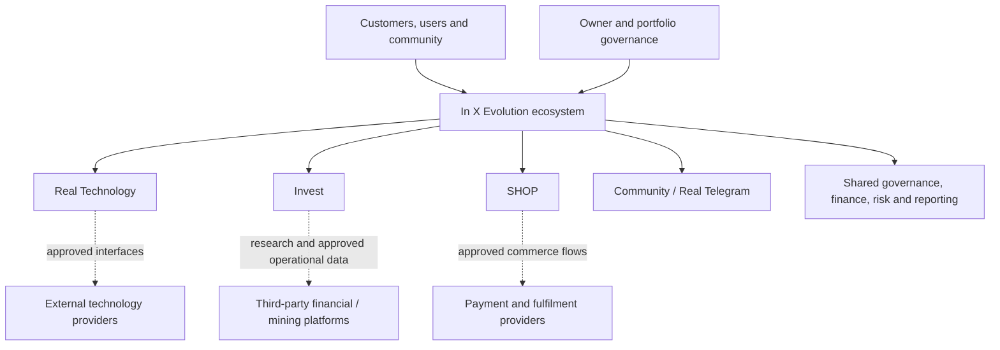
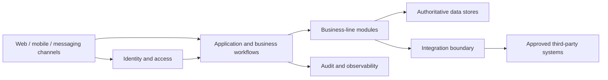

# In X Evolution — Architecture Baseline

**Version:** 0.2  
**Date:** 23 November 2026  
**Status:** Conceptual proposal — no application architecture is implemented

## 1. Architecture position

In X Evolution is being defined as a brand-led digital business ecosystem with shared governance and distinct business-line responsibilities. The repository currently contains documentation only; it does not contain an application, database, deployment environment or integration code.

The architecture must enable shared operations without collapsing the security, data ownership, financial reporting or regulatory boundaries between business lines.

## 2. Architecture principles

1. Business outcomes and validated user needs first.
2. Simple modular design before distributed services.
3. Clear boundaries between Real Technology, Invest, SHOP and community.
4. Shared governance and reporting with appropriately separated data access.
5. Security and privacy by design.
6. Explicit data ownership and source-of-truth rules.
7. Documented APIs and integration failure handling.
8. Traceability, testability and observability.
9. Recoverability and controlled change.
10. Portability, data export and provider exit planning.

## 3. Portfolio context view

The following is a proposed business/technology context, not an implementation diagram.

No provider, data exchange, transaction or deployed system is confirmed by this diagram.

## 4. Proposed logical architecture

### 4.1 Shared enterprise capabilities

- Portfolio and business-line registry.
- User identity, roles and access management.
- Customer/partner relationship management.
- Product and service catalogue.
- Workflow, task, approvals and audit records.
- Financial management reporting and cost attribution.
- Document and knowledge management.
- Notifications, monitoring and management dashboards.

Shared capabilities must support business-line scoping and separation.

### 4.2 Business-line capabilities

| Area | Candidate responsibilities | Isolation requirement |
|---|---|---|
| Real Technology | Projects, requirements, delivery, support, integrations and service-level evidence | Client and project data protected by assignment and role |
| Invest | Research sources, provider checks, internal activity/Mining records, cost and realised-result tracking | Strict separation of internal activity data, user information and credentials |
| SHOP | Products, sellers, orders, payment references, fulfilment, returns and support | Customer and transaction access restricted |
| Community | Content, announcements, moderation, member support and consent | Public community content separated from private customer records |

### 4.3 Conceptual application boundary

The actual channels, services, data stores and identity technology remain undecided.

## 5. Architectural style recommendation

Begin with a **modular monolith** unless validated requirements demonstrate a need for independent deployment, high scale, team autonomy or fault isolation. Define domain boundaries and API contracts from the start so that components can be separated later if justified.

Do not introduce microservices, event streaming or complex infrastructure solely to appear enterprise-grade. Each additional component creates operational, security and financial cost.

## 6. Data architecture

Candidate domains:
- Portfolio, legal entities and business units.
- Users, roles and access grants.
- Leads, customers, organisations and support cases.
- Products, services, suppliers and partners.
- Projects, tasks, quotes, contracts and orders.
- Financial references, costs, invoices and payment reconciliation metadata.
- Invest research sources and internal Mining activity records.
- SHOP catalogue, seller, order and fulfilment records.
- Community content and moderation records.
- Audit events, documents and consent/notice records.

For every domain, define owner, source of truth, classification, access, retention, export and correction policy.

Do not store broker passwords, wallet seed phrases, private keys, full payment-card data or unrestricted API tokens in application records or Airtable.

## 7. Airtable boundary

Airtable has previously been identified as the intended enterprise operations integration for In X Evolution Invest. It may be evaluated as an operational register/workflow layer for approved records, subject to capability, access, audit, cost and data-residency review.

Before implementation:
- Approve base/table ownership and data model.
- Identify Airtable versus external system source-of-truth fields.
- Preserve the three Mining records identified by the project owner.
- Test create, read, update and reconciliation on non-destructive sample data first.
- Keep secrets and sensitive credentials out of Airtable.
- Require explicit confirmation before deletion or destructive restructuring.
- Do not treat Airtable as a regulated custodian, payment system or statutory accounting ledger.

## 8. Integration architecture

Each integration needs:
- Named owner, business purpose and approved scope.
- Provider due diligence and contract review.
- Documented API schema, version and authentication.
- Minimum required scopes and protected secrets.
- Validation, timeout, retry and duplicate-processing strategy.
- Rate-limit and provider outage handling.
- Audit and monitoring.
- Data retention, export and provider-exit procedure.

## 9. Security and privacy architecture

- Use centralised identity where appropriate and role-based authorisation.
- Separate production from development and test.
- Restrict privileged access and use strong authentication.
- Encrypt sensitive traffic and storage according to risk.
- Keep secrets in an approved secret manager.
- Protect logs from personal and financial data leakage.
- Maintain data-flow and threat models.
- Assess GDPR and other applicable obligations before collecting personal data.

## 10. Deployment and operations

The deployment model is not selected. Before production, define:
- Hosting and network architecture.
- Environment separation.
- Build and release pipeline.
- Secrets/configuration management.
- Monitoring, alerting and audit collection.
- Backup, restore, RPO and RTO.
- Incident response and support ownership.
- Cost monitoring and capacity limits.

## 11. Technology selection criteria

Evaluate programming language, framework, database, hosting, identity, analytics and integration tools against requirements, team skills, maintainability, security, privacy, cost, availability, data export and reversibility.

No particular language, framework, database or cloud vendor is approved in this document.

## 12. Architecture exit criteria

- Purpose, first business line and user journeys approved.
- High-priority enterprise requirements testable.
- Business-line and data boundaries documented.
- Legal, privacy and security risks assessed.
- Technology decisions recorded in ADRs.
- Costed deployment model approved.
- Integration and recovery procedures reviewed.
