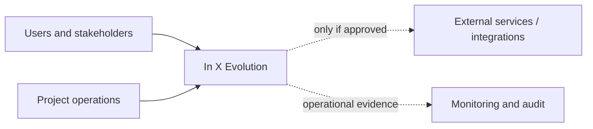

# In X Evolution — Architecture Baseline

**Version:** 0.1  
**Date:** 23 November 2026  
**Status:** Conceptual proposal — not an implemented architecture

## 1. Architecture position

The repository currently contains no application source code, deployment configuration, database schema or interface definitions. Therefore, this document defines architecture principles and a technology-neutral discovery model. It does not assert that any component is already deployed.

The detailed architecture must follow approved business requirements, data classification, security analysis, scale expectations and budget.

## 2. Architecture principles

1. **Business and user outcomes first:** technology choices must trace to approved requirements.
2. **Simplicity before distribution:** begin with the least complex architecture that satisfies the requirements; introduce services or queues only when justified.
3. **Modularity:** define clear responsibilities and stable boundaries.
4. **Security by design:** authenticate, authorise, validate and audit at appropriate trust boundaries.
5. **Privacy by design:** collect the minimum necessary data and define purpose, access, retention and deletion.
6. **Interoperability:** use documented interfaces and explicit data contracts where integration is required.
7. **Observability:** design appropriate logs, metrics and traces before production operation.
8. **Testability:** make critical behaviours verifiable through automated and manual tests.
9. **Recoverability:** define backup, restoration and incident processes according to business impact.
10. **Portability and reversibility:** avoid unnecessary provider lock-in and document migration implications.

## 3. Conceptual system context

The following is a discovery placeholder. External actors, systems and data flows must be validated with stakeholders.

No particular external provider or integration is confirmed by this diagram.

## 4. Logical capability boundaries

These are candidate architecture responsibilities, not implemented modules:

| Boundary | Responsibility to define | Key design question |
|---|---|---|
| Experience layer | User and operator interaction | Web, mobile, API, or another channel? |
| Identity and access | Authentication, roles and permissions | Which identity model and assurance level? |
| Business capability layer | Approved business rules and workflows | What are the actual capabilities? |
| Data layer | Persistence, search, retention and export | Which data, volume, sensitivity and consistency? |
| Integration boundary | External APIs and events | Which systems and contractual interfaces? |
| Operations layer | Monitoring, audit, backups and recovery | What operational service level is required? |

## 5. Architecture views to produce

Before implementation, create and approve:

- **System context view:** users, neighbouring systems, trust boundaries and data flows.
- **Container view:** deployable applications, databases, queues and their relationships.
- **Component view:** internal responsibilities for complex containers.
- **Deployment view:** environments, network boundaries, secrets, backups and observability.
- **Data view:** logical entities, ownership, classification, retention and lifecycle.
- **Threat view:** assets, actors, attack surfaces, trust boundaries and mitigations.

Use C4-style diagrams where they improve communication. Do not create detail that cannot yet be supported by requirements.

## 6. Technology selection criteria

Evaluate candidate technologies against:

| Criterion | Questions |
|---|---|
| Functional fit | Does it support the approved use cases? |
| Security | Are security controls, patching and access management adequate? |
| Privacy and compliance | Can data residency, retention, deletion and audit obligations be met? |
| Maintainability | Can the team operate and evolve it? |
| Interoperability | Are APIs, export and integration options documented? |
| Reliability | What are failure modes, recovery options and service guarantees? |
| Performance | Does it meet measured workload requirements? |
| Cost | What are setup, usage, support and exit costs? |
| Portability | How difficult is migration or replacement? |
| Ecosystem | Are dependencies maintained and supported? |

The programming language, framework, database, cloud provider and hosting model remain **undecided**.

## 7. Data architecture requirements

Before selecting a data store:

1. Identify data subjects, data owners and business entities.
2. Classify data by sensitivity and business criticality.
3. Define data quality, uniqueness, consistency and lifecycle rules.
4. Identify personal data and document purpose, lawful basis and retention requirements where applicable.
5. Define access control, encryption, backup and deletion.
6. Specify import/export and migration requirements.
7. Create a data dictionary and schema migration policy.

## 8. API and integration requirements

For every approved integration, document:

- Business purpose and accountable owner.
- System of record for each data element.
- API contract, versioning and authentication.
- Input validation and error semantics.
- Rate limits, timeouts, retries and idempotency.
- Data minimisation and retention.
- Monitoring, incident ownership and vendor exit plan.

No integration is assumed to exist.

## 9. Environments and delivery

A future implementation should define separate environments appropriate to risk, typically development, test/staging and production. Production credentials and data must not be copied into development.

The release design should specify reproducible builds, configuration management, approvals, migrations, monitoring and rollback/recovery. Exact tools are pending technology selection.

## 10. Architecture exit criteria

Architecture is ready for implementation when:

- The problem statement, actors and high-priority workflows are approved.
- Functional and non-functional requirements are baselined.
- Data classification and important data flows are understood.
- Threats and trust boundaries are assessed.
- Technology choices have documented ADRs.
- Deployment, backup, monitoring and recovery responsibilities are assigned.
- Acceptance and test strategy are agreed.
