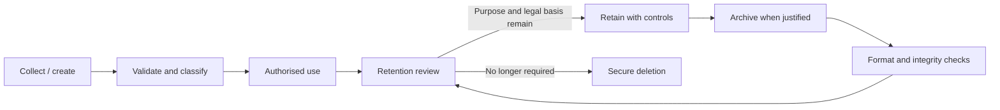

# In X Evolution — Data Architecture and Ownership

**Status:** Proposed baseline; detailed schema depends on pilot selection.

## Data architecture principles

1. Every data domain has one accountable owner.
2. Each critical field has a documented source of truth.
3. Collect only data required for a defined purpose.
4. Separate data by business line, customer and access role where required.
5. Define retention and deletion; long-term preservation is not a reason to retain personal data indefinitely.
6. Support export, correction, migration and provider exit.
7. Keep credentials, private keys and payment-card data out of ordinary business records.
8. Log data access and material changes proportionately.

## Candidate domains

| Domain | Example records | Proposed owner |
|---|---|---|
| Portfolio | Business line, objective, owner, status | Portfolio governance |
| Identity and access | User, role, access grant, authentication event | Security/technical owner |
| Customer and CRM | Organisation, contact, lead, case, consent/notice evidence | Relevant business-line owner |
| Catalogue | Product, service, price, supplier, availability | Product/commercial owner |
| Delivery | Project, requirement, task, release, defect | Product/technical owner |
| Commerce | Cart, order, fulfilment, return, payment reference | SHOP owner |
| Finance | Budget, cost, invoice reference, reconciliation, revenue | Finance owner |
| Invest operations | Research source, activity record, Mining record, cost/result evidence | Invest owner |
| Community | Public content, moderation case, member support | Community owner |
| Governance and audit | Decision, approval, risk, control, audit event | Governance/security owner |

## Classification model

| Class | Description | Handling |
|---|---|---|
| Public | Approved for public disclosure | Review before publication |
| Internal | Routine non-public business information | Authenticated staff access |
| Confidential | Commercial, customer or operationally sensitive information | Need-to-know access, controlled sharing |
| Restricted | Credentials, sensitive personal data, high-impact financial/security data | Strongest access controls; avoid storage unless essential |

Classification must be refined against applicable law and actual data types.

## Source-of-truth register template

| Data domain | Authoritative system | Owner | Consumers | Export format | Retention rule |
|---|---|---|---|---|---|
| Customer | To decide | To assign | Approved CRM/support | Open, documented format | To assess |
| Finance | Statutory accounting system to be selected | Finance | Reporting | Standard export | Legal schedule |
| Product catalogue | To decide | Commercial | SHOP/web | CSV/JSON/API | Contractual/business |
| Invest/Mining | Existing source to verify | Invest | Approved operations/reporting | Tested export | To assess |
| Identity | Approved identity provider to select | Security | Applications | Documented export where available | Security/legal |

## Airtable boundary

Airtable may support operational registers and workflows if approved after a field-level classification and access review. Before changes, verify the existing base, preserve the three Mining records referenced by the project owner, establish record identifiers and export a recoverable snapshot. Test on non-destructive samples first. No destructive operation is authorised by this document.

Airtable must not be treated as a substitute for a statutory accounting ledger, regulated custodian or secure secrets vault.

## Data lifecycle

## Required controls

- Data inventory and processing purpose.
- Lawful basis and privacy notice where personal data is processed.
- Access matrix and periodic access review.
- Encryption and backup according to risk.
- Integrity checks and tested restore.
- Retention schedule and deletion evidence.
- Data subject request and incident workflows where applicable.
- Export and migration tests for critical records.
