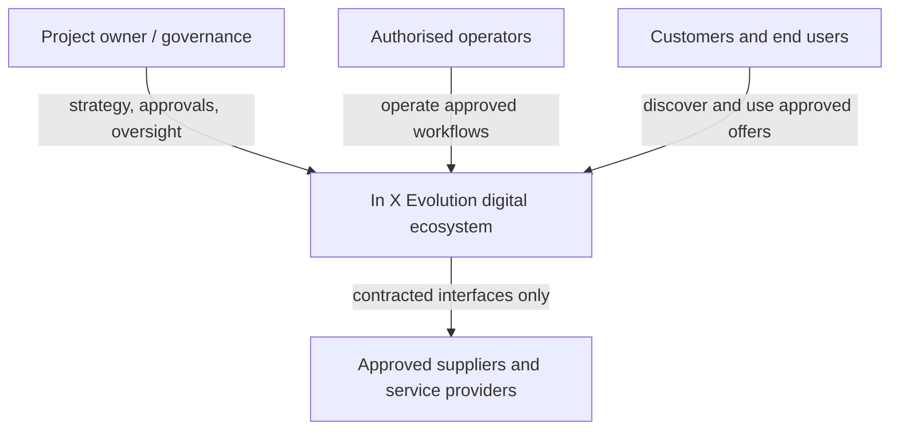
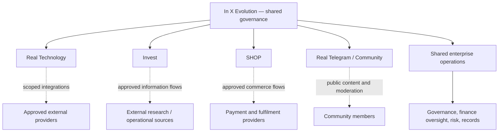

# In X Evolution — C4 Context View

**Status:** Conceptual proposal; validate after selecting the pilot.

## System context

## Portfolio context (proposed)

This is a business context map, not proof that the business units, contracts, products or integrations currently exist.

## External actor catalogue

| Actor | Interaction | Trust boundary |
|---|---|---|
| Project owner | Approves strategy, scope, budget and risk | Privileged governance access |
| Internal operator | Performs assigned business tasks | Authenticated, role-scoped access |
| Customer/end user | Uses an approved product or service | Public/user boundary |
| Supplier/provider | Provides a contracted capability | External system boundary |
| Regulator/adviser | Receives information or provides advice where required | Formal, purpose-limited exchange |

## Context-level security rules

- External actors receive only the minimum access required for a defined purpose.
- Administrative access is separate from ordinary customer access.
- Each portfolio area has an explicit data owner and access policy.
- Third-party connections require documented purpose, contract, authentication, data scope and exit procedure.
- Public community content must not expose private customer, financial or operational records.

## Open questions

1. Which single business line is the first pilot?
2. Which customer journey is in scope?
3. Which legal entity contracts with customers and providers?
4. Which external providers are actually required?
5. Which data controller/processor roles apply?
