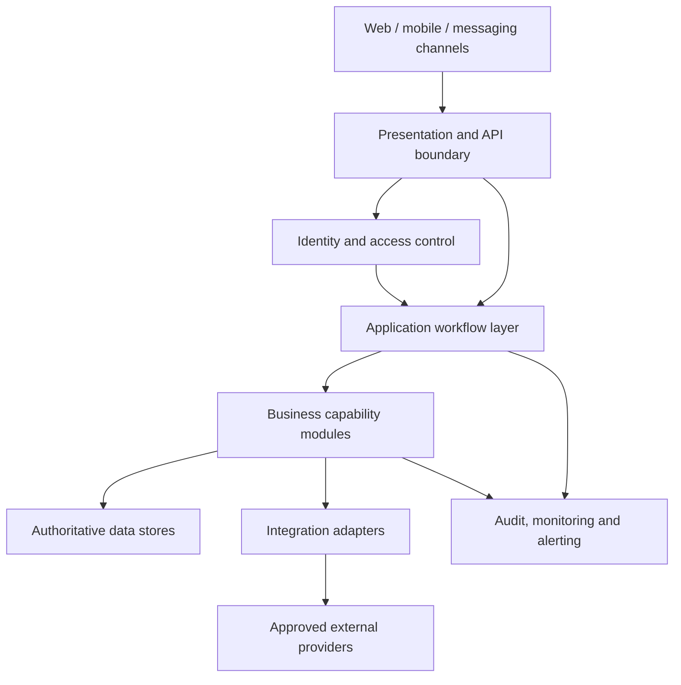

# In X Evolution — Logical Container Architecture

**Status:** Technology-neutral proposal. Containers below are logical responsibilities, not deployed services.

## Proposed logical view

## Logical responsibilities

| Logical container | Responsibility | Security requirement |
|---|---|---|
| Presentation/API boundary | Input validation, request routing, response shaping | Rate limits, validation, secure transport |
| Identity and access | Authentication, roles, session and access decisions | Strong authentication, least privilege |
| Application workflows | Use cases, orchestration and business rules | Authorisation at every sensitive operation |
| Domain modules | Portfolio-specific rules and entities | Explicit domain and tenant/business-line boundaries |
| Data stores | Persist authoritative records | Classification, encryption, backup, access logging |
| Integration adapters | Connect approved external services | Scoped credentials, timeouts, retries, idempotency |
| Audit/observability | Operational events, security events and metrics | Minimise sensitive data in logs; restrict log access |

## Initial deployment recommendation

Start with one deployable modular application and managed supporting services only where justified. Separate modules by business capability and enforce boundaries in code and data access. Extract a module into a separately deployed service only when measured scale, isolation, team ownership, regulatory need or availability requirements justify the added complexity.

## Required design controls

- No direct database access from presentation code.
- Validate and authorise at the server-side boundary.
- Keep secrets outside source control and ordinary business tables.
- Define transaction boundaries and idempotency for retried operations.
- Record security-relevant events without logging credentials or unnecessary personal data.
- Maintain separate development, test and production environments.
- Document health checks, dependency failure behaviour and recovery procedures.

## Not yet selected

Programming language, framework, database engine, hosting provider, message broker, identity provider, API gateway and observability vendor remain open. Select them only after requirements, team capability, security, cost and exit criteria are assessed.
